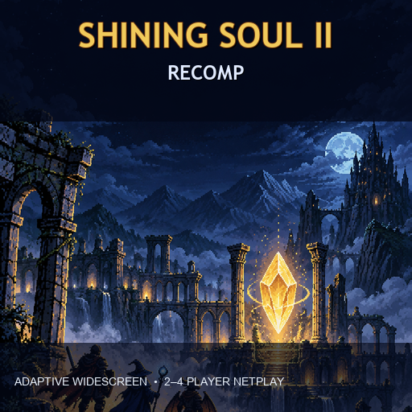

# ShiningSoul2Recomp

<p align="center">
  
</p>

<p align="center">
  <a href="https://github.com/MatyMeatBoy/SS2Recomp/releases/latest"></a>
  <a href="https://github.com/MatyMeatBoy/SS2Recomp/releases"></a>
  <a href="https://github.com/MatyMeatBoy/SS2Recomp/blob/master/LICENSE"></a>
</p>

Recompilación estática de **Shining Soul II (Europe, AU2P)** basada en
gbarecomp. Incluye vista adaptativa 16:9 con datos reales del mapa, soporte de
multijugador por cable emulado para 2 a 4 jugadores y la infraestructura de
salas/netplay de recomp-ui.

## Estado actual

| Área | Estado |
| --- | --- |
| Recompilación estática | Verificada en los recorridos cubiertos |
| Widescreen adaptativo | Campo 16:9 con mapa real a ambos lados |
| Netplay 2 jugadores | Integrado |
| Netplay 3–4 jugadores | Integrado; delay-sync recomendado |
| Rollback 4 jugadores | Experimental, probado con red degradada |
| Release Windows x64 | [v0.2.2](https://github.com/MatyMeatBoy/SS2Recomp/releases/tag/v0.2.2) |

La prioridad de esta etapa es ampliar las pruebas entre PCs reales, cubrir más
escenas del juego y validar reconexión durante una partida prolongada.

La arquitectura está explicada en [docs/ARCHITECTURE.md](docs/ARCHITECTURE.md).
Consulta también la [matriz de pruebas y límites del online](docs/NETPLAY_VALIDATION.md).

El proyecto no incluye ROM, BIOS, partidas, estados ni código generado. Cada
usuario debe aportar legalmente su propia copia de la ROM y su propio dump de
BIOS.

## Instalación rápida en Windows

1. Descarga y extrae todo el ZIP, conservando las carpetas `build` y `tools`.
2. Ejecuta el programa. El launcher permite seleccionar la ROM y el BIOS.
   También puedes colocarlos localmente según `game.toml`:
   `roms/shining_soul_2_europe.gba` y `gbarecomp/bios/gba_bios.bin`.
3. El BIOS debe ser un dump propio de 16 KiB con SHA-1
   `300c20df6731a33952ded8c436f7f186d25d3492`.
4. La ROM compatible es Shining Soul II Europe AU2P, SHA-1
   `aa1288be9257337abdfe3034898cf6c7aa778fbc`.

El archivo `Jugar ShiningSoul2Recomp.bat` abre el ejecutable. La vista de campo
empieza en 284x160, que conserva los 160 píxeles verticales y usa el ancho
lógico aproximado de 16:9. En pantalla completa se adapta al monitor. El mapa
original se consulta desde EWRAM o ROM; no se repiten tiles ni se estiran
personajes. Los menús, diálogos y escenas sin un mapa de campo reconocido
conservan composición nativa centrada.

## Multijugador

El perfil recomendado de esta versión es el botón **Netplay (experimental)**:
TCP directo con recuperación automática para 2–4 jugadores. Se verificaron
cortes de 65 segundos, reinicio del host, del invitado y divergencia transitoria
en pruebas locales. [Configuración y límites](docs/NETPLAY_RECOVERY.md).

Los ejemplos siguientes describen el transporte UDP anterior, todavía disponible.

Cada proceso simula todas las consolas de la sesión y comparte las entradas,
snapshots y el estado de sincronización. El asiento 0 actúa como hub directo para tres o
cuatro jugadores; con dos jugadores se usa el enlace par a par. Para internet
se puede usar Hamachi, Tailscale o una red con puertos UDP accesibles. La
base admite lobby y relay; su funcionamiento en una sesión pública de este
proyecto todavía requiere validación. Hamachi y Tailscale no se han probado
entre PCs en esta revisión.

Ejemplo del host, con cuatro jugadores:

```text
ShiningSoul2Recomp.exe --netplay-players 4 --netplay-seat 0 --netplay-session 41011 --netplay-bind 0.0.0.0:21940 --netplay-delay-sync
```

Ejemplo de un cliente:

```text
ShiningSoul2Recomp.exe --netplay-players 4 --netplay-seat 1 --netplay-session 41011 --netplay-bind 0.0.0.0:21941 --netplay-peer IP_DEL_HOST:21940 --netplay-delay-sync
```

Para usar rollback sustituye `--netplay-delay-sync` por
`--netplay-rollback`. Con 3 o 4 jugadores el modo de retraso es el
predeterminado; rollback queda disponible de forma explícita.

Las partidas enlazadas usan checkpoints emparejados. Al guardar y salir, todos
los participantes deben conservar el archivo `.paired` para poder reanudar la
misma sesión.

## Pruebas reproducibles

Las pruebas locales no usan sonido y no modifican las partidas del usuario:

```text
py -3.12 re/test_widescreen.py
py -3.12 re/test_netplay_local.py --mode delay-sync --frames 240 --latency-ms 45 --jitter-ms 15 --loss 0.015
py -3.12 re/test_netplay_local.py --mode rollback --frames 240 --latency-ms 45 --jitter-ms 15 --loss 0.015
```

Las pruebas completadas antes de esta release ejecutaron cuatro procesos,
240 ticks y pérdida simulada; ambos modos produjeron checkpoints con SHA-256
idéntico en los cuatro asientos. La cobertura de ejecución fue `FULLY_STATIC`,
con cero instrucciones interpretadas y cero dispatch misses en los recorridos
verificados.

Estas pruebas validan el transporte y la determinación de la sesión. No
sustituyen una partida prolongada entre cuatro PCs reales ni certifican todos
los routers, VPN o proveedores de internet.

La revisión posterior amplió las pruebas a 2, 3 y 4 procesos y corrigió la
instalación del dispatcher Flash en cada consola. Las pruebas usan entradas
neutras y reportaron cero ticks de replay, por lo que aún no validan
correcciones de rollback durante gameplay. Un corte de red de dos segundos
impidió completar una prueba de cuatro jugadores dentro de 60 segundos;
ese resultado corresponde al transporte UDP anterior. El nuevo perfil TCP
recuperable pasó los escenarios documentados en la matriz enlazada arriba.

Las pruebas posteriores con controles distintos observaron un tick de rollback
corregido por proceso en loopback. Bajo estrés mayor, rollback rechazó un
checkpoint por divergencia; delay-sync sí acordó estados idénticos. Por ahora
se mantiene el estado experimental. Estos controles se probaron en la selección
de clases, y todavía falta verificar combate enlazado.

## Compilación

Se requiere CMake, un compilador MinGW compatible con SDL2 y Python 3.12 para
las pruebas. `tools/regen.ps1` regenera el código desde una ROM verificada y
`tools/regen_bios.ps1` regenera la parte del BIOS desde el dump local. Nunca se
edita `generated/` a mano. Antes de configurar una copia recién clonada,
ejecuta `powershell -ExecutionPolicy Bypass -File tools/prepare_gbarecomp.ps1`
para fijar la versión de recomp-net usada por esta release.

### Online recuperable (Windows, experimental)

El botón **Netplay (experimental)** conecta por TCP directo con recuperación
automática de cortes y reentrada de procesos. El host conserva un checkpoint y
un diario de controles confirmados; un supervisor interno recupera crashes de Windows.
Compatible con 2–4 participantes en LAN o VPN/Hamachi. Puede pausar durante la
espera; el host original debe volver. El modo UDP/rollback y el relay anterior
siguen disponibles, con sus límites de validación.

[Inicio, diseño y límites](docs/NETPLAY_RECOVERY.md) ·
[Pruebas y evidencia](docs/NETPLAY_VALIDATION.md).

Para reconstruir, ejecuta `tools/prepare_gbarecomp.ps1` tras inicializar los
submódulos: aplica los parches de runtime usados por este proyecto.

## Créditos y licencia

El proyecto de aplicación se publica bajo MIT. gbarecomp, recomp-ui,
recomp-net y sus dependencias mantienen sus propias licencias y avisos. Shining
Soul II y su contenido pertenecen a sus respectivos titulares; este repositorio
no distribuye material de Nintendo.
